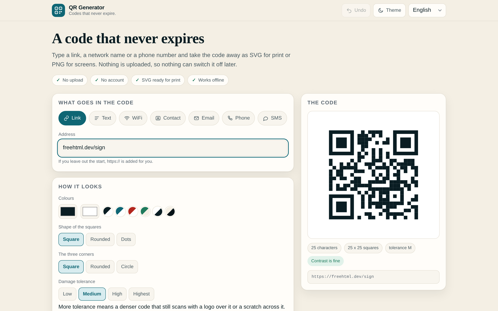

# QR Generator

**A code that never expires.**

[](https://tekideki.github.io/QR-Generator/)
[](LICENSE)



QR Generator turns a link, a short text, a WiFi network, a contact card, an email, a phone number or an SMS into a square that a phone can read. It runs entirely in the browser: no server, no account, no analytics, and nothing you type leaves the tab.

The point is what it does **not** do. Most free generators hand you a code that lives on their server, which is why it stops working after a trial, why the download asks for an account, and why a printed leaflet dies the day someone cancels a subscription. A code made here is the data itself, drawn by your own browser, so there is nothing behind it that can be switched off.

---

## What it does

- **Seven kinds of code.** A link, plain text, a WiFi network (including a hidden one), a contact card, an email with subject and body, a phone number, an SMS with a message.
- **SVG for print, PNG for screens.** The SVG is real vector at any size, which is what a print shop wants. The PNG comes at 512, 1024 or 2048 px, with a quiet zone around the code, so it scans on a poster as well as on a business card.
- **A sheet at once.** Paste one address per line and get an A4 sheet of codes with captions, laid out for printing and cutting.
- **Shape, colours, corners, logo.** Square, rounded or dotted modules; square, rounded or circular corners; a logo read from your own disk and drawn into the code.
- **Honest warnings.** Contrast is measured, not guessed, and a logo over a code with low damage tolerance is called out before you print it.
- **Four languages.** English first, then Romanian, Serbian Latin and Serbian Cyrillic. The chosen language is remembered.
- **Works offline.** Install it from the browser and it keeps working with the network off.

## How to use it

1. Pick what goes in the code.
2. Fill the fields. The code appears as you type.
3. Check the warnings. Low contrast or a logo on a weak tolerance will not scan in the real world.
4. Take the **SVG** for a printer, or the **PNG** for a screen.
5. For a run of codes, paste the addresses in the sheet box and print.

## Why it is built this way

**No network at all.** The page ships as one HTML file with no request to anywhere. The test suite checks that no external request is made while the page works.

**The encoder is a copy, not a dependency.** `src/qr.js` is Kazuhiko Arase's MIT licensed QR encoder, vendored into the file so the app keeps working offline and the build stays reproducible.

**The code is drawn by us, not by a library.** The encoder returns a matrix of dark and light; everything after that, the shapes, the corners, the logo, the quiet zone, is drawn here, which is why the preview, the SVG and the PNG always agree.

**Warnings are measurements.** Contrast uses the real WCAG ratio of the two colours you picked. The character count and the module count come from the encoder, not from a guess.

**Deterministic build.** The same sources always produce a byte identical `index.html`, and the Serbian Cyrillic locale is transliterated from the Latin one by the build, so the two can never disagree.

## Develop

```bash
python3 build.py                 # writes index.html from src/
node tests/logic_test.cjs        # payload rules and the encoder
python3 tests/ui_test.py         # the page in a real browser
BROWSER=firefox python3 tests/ui_test.py
python3 tools/make_icons.py      # icons, favicon, touch icon
python3 tools/make_screenshots.py
```

`src/payload.js` turns the form into the exact string a phone expects, and it is plain enough to be tested without a browser. That is where the escaping rules for WiFi and vCard live, and where a hostile network name is stopped from breaking the payload.

## Privacy

Nothing is uploaded. The fields are read by the page, the code is drawn by the page, and the only thing kept between visits is the form itself, in `localStorage`, on your machine. The page makes no network request, and the service worker only exists so the shell opens offline.

## Licence

Apache 2.0 for this app. `src/qr.js` is MIT, copyright Kazuhiko Arase, and the notice is kept in `NOTICE`. The words QR Code are a registered trademark of DENSO WAVE INCORPORATED.
